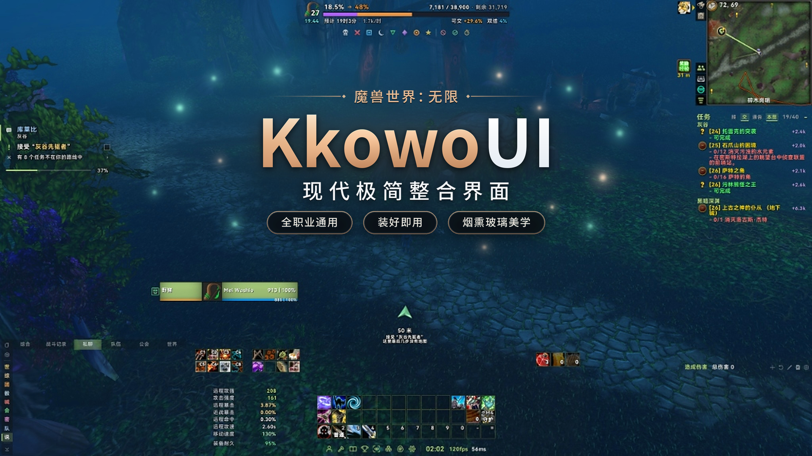

# kkowoUI



面向《魔兽世界：无限》（WoW Forever，Interface `16001`）的模块化界面增强套件，基于 [EllesmereUI](https://www.curseforge.com/wow/addons/ellesmereui) 构建，游戏内输入 `/kk` 打开设置面板。

当前版本：**v2.0.0**（旧版 `KkowoUI` / `ForeverUI` 存档自动迁移，设置不丢失）。

## 安装

将仓库 `Addon/` 下的全部 9 个 `kkowoUI*` 目录复制到 `_forever_\Interface\AddOns\`，并确保已安装 EllesmereUI。

如同时使用 EllesmereUIChat 与 Polestar，可在退出游戏后运行：

```bash
python Tools/apply_patches.py --apply
```

仅包含 2 个极简功能补丁（聊天标签瞬切 + Polestar 导航优化，并在 `.toc` 中统一标记 `by kkowo`）与 1 个可选独立插件脱钩改名（`Scales` → `Scales_kkowo` / `Scales by kkowo`），不新增其他第三方文件修改。

## 模块结构

| 子插件 | 加载方式 | 说明 |
| --- | --- | --- |
| `kkowoUI` | 常驻 | 核心框架、主题与安全圆角引擎、双层液态流与原生平滑动效引擎、存档、守卫、只读实机录制器与 ESC 队列 |
| `kkowoUI_Media` | 常驻 | 字体、POT 液态流光与条体明暗材质、1024×1024 SDF 团队标记图集、法术书/天赋/系统栏图标、光柱与音效资源 |
| `kkowoUI_CoreHUD` | 常驻 | 双翼血蓝条（含回蓝节拍与治疗预估）与技能球、低血量提醒、动效总控与对比演示、施法/挥砍/冷却追踪/动作条/姓名板/增益全统一动效 |
| `kkowoUI_QoL` | 常驻 | 任务接交与快捷条、平滑经验条、3D 地图光柱与场景快捷键点地插旗（`GroundPin`）、扁平 Roll 点条、拾取播报、标记条、聊天条、系统栏、耐久与装备一览 |
| `kkowoUI_Tooltip` | 常驻 | 内嵌 PrettyTooltip（MIT）与全界面圆角提示框样式、商人行去重与物品页脚智能防隔行 |
| `kkowoUI_Integrations` | 常驻 | EUI / Polestar / Auctionator / 伤害统计美化、运行时修复、常用插件运行时简体中文补全、主城减卡 |
| `kkowoUI_ClassPack` | 常驻 | 术士灵魂石提醒、猎人技能音效、武器附魔/特效统一计时条（引擎行零钩子液态流）、职业表情喊话 |
| `kkowoUI_Options` | 按需加载 | `/kk` 设置面板（6 组 24 页）、总控台与 `/kk selftest` / `/kk doctor` / `/kk clickcheck` / `/kk fade why` |
| `kkowoUI_KeybindBoard` | 按需加载 | `/kkkeys` 可视化键位图，支持拖拽绑键与多种键盘尺寸 |

## 主要功能

- **战斗 HUD 与全条类统一动效**：双翼血蓝条、职业技能球、原生平滑插值、治疗预估与受击/治疗柔光、0-OnUpdate 机密安全蓝条 5 秒/2 秒回蓝节拍；双层无缝连续液态流动（`fx_barFlow`）并全量统一施法条、挥砍条、EUI 冷却追踪条、武器附魔/特效条、Roll 点条、经验条与伤害统计条的液态玻璃质感（客户端 `SetTimerDuration` 计时 + 完整圆角遮罩防末端变矩形）；当前目标姓名板圆角绘制描边、按键下沉回弹与平滑曲线脱战淡隐（`/kk motion demo` 支持脱战实时对比）。
- **地图标记、点地光柱与任务**：大地图/小地图 `Ctrl/Shift+左键` 与 3D 世界快捷键点地插旗（`GroundPin` 两帧透视求解 + `/kk navprobe` 校准），联动 3D 渐变光柱与北极星导航（距离显示为「米」，支持手动落点门控）；自动接交任务、任务等级与经验估算、平滑经验速率条、采集提醒。
- **拾取、Roll、标记与提示框**：紧凑尾淡拾取微播报（支持 `0.11s` 依次错峰滑入/滑出与同类合并）、零挡点击扁平 Roll 点条、1:1 40px 高清头顶团队标记与按钮缩放；提示框去重 Auctionator 商人行、物品页脚全宽防隔行与紧凑金币排版。
- **聊天、系统栏与面板美化**：左侧融合聊天条（与聊天框同步淡隐）、`eui_chat_tab_fast v6` 战斗记录标签瞬切、圆角聊天气泡、系统栏法术书与天赋双钮独立图标、法术书搜索框零跳动、人物面板装备一览、拍卖行精简合并、一键 ESC 关闭主流插件窗口。
- **零补丁运行时汉化**：为 Polestar、GTFO、Auctionator、BigWigs_Classic、EllesmereUIQoL 与提示框设置页按需补齐简体中文，官方译文优先。
- **WoW 12.1 副本机密值与回归保障**：全模块适配 12.1 机密值（AuraContainer 引擎按钮零脚本处理器、Buff 父框体圆角与安全方形降级、幂等换图防脱罩与防清计时器），内置常驻只读副本录制器、1,200 事件黑暗深渊离线回放框架、静态检查器（`Tools/check.js`）与 44 项离线回归测试。

## 常用命令

| 命令 | 作用 |
| --- | --- |
| `/kk` | 打开设置面板（别名 `/kkowoui`、`/fui`） |
| `/kk keys` | 打开可视化键位图 |
| `/kk unlock` | 进入 EUI 解锁模式调整框体位置 |
| `/kk status` | 查看版本与各模块运行状态 |
| `/kk doctor` / `/kk selftest` | 插件环境体检 / 自动化自检 |
| `/kk clickcheck` / `/kk fade why` | 隐形挡点击全屏排查 / 脱战淡隐条件诊断（战斗安全只读） |
| `/kk motion demo` / `/kk navprobe` | 条形动效新旧对比演示 / 点地光柱透视探针 |
| `/kk rec` | 副本只读录制器状态与开关（`on` / `off` / `mark` / `clear`） |
| `/kk slim` / `/kk restore` | 停用冗余插件 / 还原 |
| `/kk hud` / `/kk perf` / `/kk friendly` | 切换脱战淡隐 / 场景稳帧 / 友方姓名板模式 |
| `/kk toast` / `/kk ss` / `/kk wp` | 预览拾取播报 / 灵魂石提醒 / 武器特效条 |

## 更新日志

### v2.0.0
- **架构重构与 6 组设置面板**：拆分为 9 个独立子插件（资源分离至 `kkowoUI_Media`，设置页与键位图改为 `LoadOnDemand` 按需加载；内嵌 MIT 版 `kkowoUI_Tooltip`）；重组为 6 组 24 页，全面精简 897 条界面文案；旧版 `KkowoUI` / `ForeverUI` 存档自动无损迁移。
- **条形质感与双层连续液态流动**：新增 `motionFX` 动效总控与 `/kk motion demo` 对比面板；自制 POT 条体明暗填充、柔光火花与双层 C∞ 水平无缝液态流动贴图（纯 C 端 `AnimationGroup`，0 `OnUpdate`）；全量统一血蓝条、施法条、挥砍条（彻底根治末端变矩形）、EUI 冷却追踪条、武器附魔/特效条（引擎行与自绘行一致）、Roll 点条、经验条与伤害统计条的液态玻璃质感，支持停用无损还原。
- **战斗与界面体验打磨**：新增蓝条 0-OnUpdate 机密安全回蓝节拍火花、目标光环竖线分隔与自身光环一键切换、Buff 图标父框体圆角遮罩（含安全方形降级）、头顶团队标记 1:1 40px 锁定与按钮缩放、系统栏法术书/天赋双钮重绘与法术书搜索框零跳动、提示框商人行去重与物品页脚全宽防隔行。
- **3D 光柱与场景点地导航**：新增大地图/小地图 `Ctrl/Shift+左键` 3D 渐变光柱及 `GroundPin` 快捷键点地插旗（两帧透视求解 + `/kk navprobe` 校准），联动北极星导航（`polestar_nav_optimize v3`）。
- **聊天瞬切与零补丁汉化**：升级 `eui_chat_tab_fast` 至 v6，战斗记录统一走 EUI 渲染与细滚动条，标签瞬切零重排；左侧聊天条与 EUI 聊天框 1:1 同步淡隐；运行时按需补全 Polestar、GTFO、Auctionator、BigWigs_Classic、EllesmereUIQoL 与提示框简体中文。
- **WoW 12.1 副本机密值加固与全链路回归**：彻底排查并修复副本/战斗机密值报错（移除 AuraContainer 引擎按钮脚本钩子、修复脱战机密值淡隐失效、消除 Roll 条挡点击、幂等换图避免实时脱罩）；新增常驻只读副本录制器、1,200 事件黑暗深渊实机回放、增强版静态检查器（75 个 Lua 文件 0 错 0 警）与 **44/44 离线回归测试全通过**；完善 `Tools/update_upstream.py`（支持 `DungeonsForever` 及 `QuestieDB` 无限服净包裁剪）。

### 历史版本
- **v1.5.1**：修复 12.1 引擎 9 宫格圆角遮罩空图问题，新增 1024×1024 SDF 高清团队标记与 Roll 点条层级优化。
- **v1.5.0**：新增武器附魔/特效计时条，脱战淡隐合并为统一开关。
- **v1.4.0**：圆角与战斗动效改版，新增人物面板装备一览与可视化键位图。
- **v1.3.x**：正式定名 `kkowoUI`，统一提示框、气泡、拍卖行、角色面板与经验条风格。

## 许可

kkowoUI 原创代码、贴图与脚本采用 **CC BY-NC-SA 4.0**（署名-非商业性使用-相同方式共享 4.0）许可发布（见 [LICENSE](LICENSE)）：

- 欢迎个人免费游玩、学习及非商业分享（须保留 `Innateyi / kkowoUI` 署名与仓库链接，修改后公开分发须采用相同协议）。
- **禁止一切商业用途**（含平台售卖、付费群/付费链接分发、商业打包搭售等）。
- `Addon/kkowoUI_Tooltip/Vendor/` 保留上游 PrettyTooltip 原 MIT 许可；EllesmereUI、Polestar 等第三方插件版权归各自作者所有。
